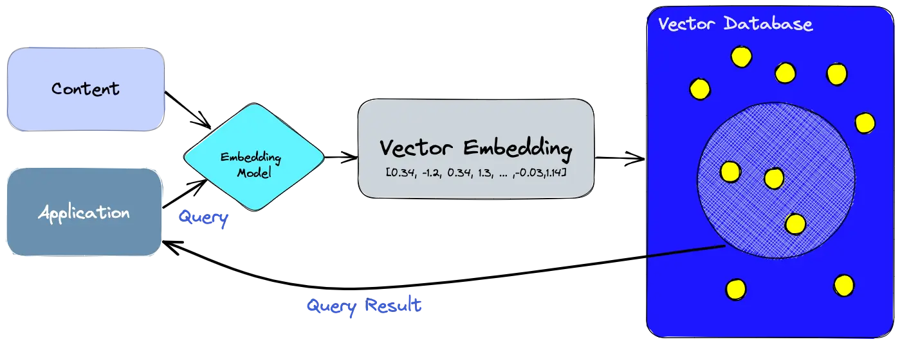

# Log Anomaly Detector
Log Anomaly Detector (LAD): Real-time system for semantic log monitoring and anomaly detection using Rust, Python, and Qdrant

# LAD — Log Anomaly Detector

Real-time log monitoring & semantic anomaly detection using Fluentd, Qdrant, and Google Gemini embeddings.



---

LAD helps you continuously monitor log files and detect anomalies (errors, warnings, unusual behavior) by:

- Collecting logs from multiple sources via Fluentd.  
- Buffering them in live log files.  
- Embedding log lines using semantic embeddings (Google Gemini).  
- Storing embeddings in Qdrant vector database.  
- Running similarity search + a prompt chain (RAG) to classify whether a log line is anomalous and suggest context/fix.  

--- 

## Project Structure

```
LAD/
├── data/
│   └── sample_logs/          # Apache and Windows sample datasets
├── daemon/                   # Fluentd config and log file watcher
│   ├── config.yaml
│   ├── daemon.py
│   ├── docker_run
│   ├── etc/
│   │   └── fluent.conf
│   ├── fluent.conf
│   └── logs/                  # Fluentd buffer and rotated runtime logs
├── docs/
│   └── assets/                # Documentation images
├── scripts/                  # Core Python scripts
│   ├── client.py
│   ├── log_ingestion.py
│   ├── main.py
│   ├── rag_chain.py
│   ├── text_utils.py
│   └── vectorstore.py
├── config/                   # Additional configuration
├── consumer/                 # Consumer application
├── frontend/                 # Frontend application
├── tests/                    # Unit and integration tests
├── operate.sh                # Starts Fluentd and Python processes
├── requirements.txt
└── README.md
```

---


---

## Setup & Installation

1. **Clone the repo**

   ```bash
   git clone https://github.com/CrAnish07/LAD.git
   cd LAD

2. **Create Python virtual environment**
   
   ```bash
   python3 -m venv venv
   source venv/bin/activate

3. **Install Python dependencies**

   ```bash
   pip install -r requirements.txt

4. **Configure Fluentd**

   Edit daemon/config.yaml to specify the log paths you want to monitor.
   Fluentd configuration is in daemon/fluent.conf.

   Copy `.env.example` to `.env` and set `GOOGLE_API_KEY` to your Google AI
   Studio API key. `operate.sh` starts a local Qdrant container automatically
   unless `QDRANT_HOST` is set in the shell or `.env`.

5. **Start services**

   ```bash
   ./operate.sh <seconds_to_run>

The script will:

- Start Fluentd (Docker) with correct mounts & user permissions.

- Run daemon.py to tail/forward logs.

- Run main.py to detect anomalies.

- After the duration, stop everything and optionally clear logs.
